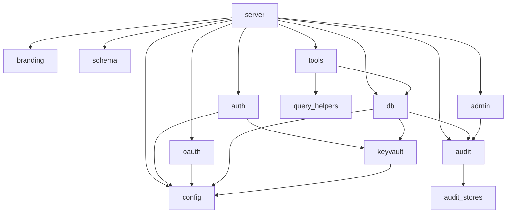
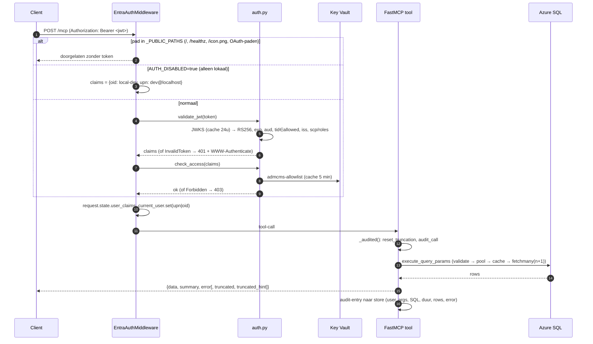
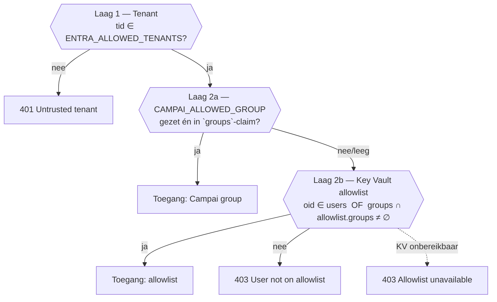
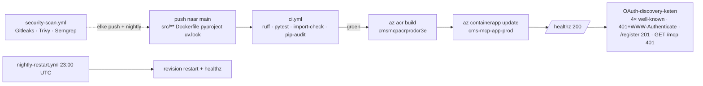

# AzureMCP-CMS — Architectuur, flows, autorisatie en tools

> **Levende documentatie.** Dit bestand is de bron van waarheid over *hoe de code werkt*.
> Het wordt bijgewerkt in **dezelfde commit** als elke code-wijziging die iets verandert aan
> auth, autorisatie, endpoints, tools, data-laag, config of deploy (zie [`CLAUDE.md`](../CLAUDE.md)).
> Verifieer bij twijfel altijd tegen de code; de bestandsverwijzingen hieronder zijn daarvoor.
>
> Laatst geverifieerd tegen commit `22be027` (main) — 2026-08-27.
>
> De app antwoordt op twee hostnames: `admcms.campai.nl` (Campai) en
> `mcp-cms-adm.cmsnl.com` (klantnaam). Beide hebben een managed certificate en
> beschrijven zichzelf in de OAuth-metadata.

---

## Inhoud

1. [Overzicht in één beeld](#1-overzicht-in-één-beeld)
2. [Repo- en modulestructuur](#2-repo--en-modulestructuur)
3. [Request-flow door de server](#3-request-flow-door-de-server)
4. [Authenticatie — OAuth 2.1 met Entra ID](#4-authenticatie--oauth-21-met-entra-id)
5. [Autorisatie — tenants, groepen en allowlist](#5-autorisatie--tenants-groepen-en-allowlist)
6. [Tools — wat er is en wat ze doen](#6-tools--wat-er-is-en-wat-ze-doen)
7. [Data-laag — SQL-veiligheid, pool, cache, limieten](#7-data-laag--sql-veiligheid-pool-cache-limieten)
8. [Audit en admin-endpoints](#8-audit-en-admin-endpoints)
9. [Configuratie en secrets](#9-configuratie-en-secrets)
10. [Deploy, CI en runtime](#10-deploy-ci-en-runtime)
11. [Bekende afwijkingen en aandachtspunten](#11-bekende-afwijkingen-en-aandachtspunten)
12. [Onderhoud van dit document](#12-onderhoud-van-dit-document)

---

## 1. Overzicht in één beeld

Een **remote MCP-server** (Model Context Protocol, Streamable HTTP) die read-only
toegang geeft tot de ADMCMS-database van CMS Lelystad. Gehost door Campai in Azure
Container Apps. Clients (Claude, Claude Code, Cursor, VS Code, Copilot Studio) loggen
in met hun **eigen Microsoft-account** via Entra ID; de server valideert het token,
controleert groepslidmaatschap en vertaalt tool-aanroepen naar geparametriseerde
SELECT-queries.

```mermaid
flowchart LR
    subgraph Client["MCP-client (Claude / Cursor / VS Code / Copilot Studio)"]
        U[Gebruiker]
    end

    subgraph Entra["Microsoft Entra ID"]
        E1[Campai-tenant<br/>bf030cec-…]
        E2[CMS Lelystad-tenant<br/>a92e7c27-…]
        APP[App-registratie CMS-MCP-API<br/>multi-tenant, scope admcms.read]
    end

    subgraph ACA["Azure Container Apps — cms-mcp-app-prod"]
        direction TB
        MW[EntraAuthMiddleware<br/>JWT + allowlist]
        OA[OAuth-proxy<br/>/.well-known /register /authorize /token]
        MCP[FastMCP<br/>/mcp — 25 tools]
        ADM[/admin/*]
        AUD[(Audit<br/>Azure Table Storage)]
    end

    KV[(Key Vault<br/>cms-mcp-kv-prod<br/>db-user, db-password, allowlist)]
    DB[(Azure SQL cmsnl<br/>ADMCMS-PRODUCTION-REPL01<br/>db_datareader)]

    U -- "1. URL invoeren" --> OA
    OA -- "2. redirect / token-proxy" --> APP
    U -- "3. Bearer JWT" --> MW
    MW --> MCP
    MW --> ADM
    MW -. "allowlist (TTL 5 min)" .-> KV
    MCP -- "SELECT only, pool max 8" --> DB
    MCP -. "db-credentials (1x per proces)" .-> KV
    MCP --> AUD
    ADM --> AUD
```

**Kernprincipes**

| Principe | Hoe afgedwongen | Waar |
|---|---|---|
| Alleen lezen | `validate_query` (SELECT/WITH-only + keyword-blacklist), DB-login is `db_datareader` | [`db.py`](../src/admcms_mcp/db.py) |
| Geen eigen identity provider | Entra is enige IdP; server proxyt alleen | [`oauth.py`](../src/admcms_mcp/oauth.py) |
| Fail-closed auth | Elke onverwachte fout in middleware → 401 | [`server.py`](../src/admcms_mcp/server.py) `EntraAuthMiddleware` |
| Geen secrets in image/env | Key Vault via Managed Identity | [`keyvault.py`](../src/admcms_mcp/keyvault.py) |
| Alles geaudit | Elke tool-call via `_audited()` → audit store | [`server.py`](../src/admcms_mcp/server.py), [`audit.py`](../src/admcms_mcp/audit.py) |
| Afkapping nooit stil | `truncated: true` + hint in elke afgekapte response | [`server.py`](../src/admcms_mcp/server.py) `_audited`, [`db.py`](../src/admcms_mcp/db.py) |

---

## 2. Repo- en modulestructuur

```
src/admcms_mcp/
├── server.py        Starlette-app, middleware, routes, FastMCP + tool-registratie (25 @mcp.tool)
├── oauth.py         OAuth 2.1 discovery (RFC 9728/8414), DCR-stub (RFC 7591), /authorize + /token proxy
├── auth.py          JWT-validatie (JWKS, aud, iss, tid, scope/role) + allowlist-check (check_access)
├── config.py        Pydantic Settings (env / .env), géén secrets
├── keyvault.py      get_secret(): Key Vault via DefaultAzureCredential, env-override voor lokaal
├── db.py            validate_query, connection-pool (8), query-cache (10 min), row-cap, truncation-flag
├── tools.py         Pure tool-functies (SQL-opbouw + shaping) — 23 datatools
├── query_helpers.py admcms_date, build_filter_where, paging, shift_year, sanitize_like, format_response
├── schema.py        SCHEMA_KNOWLEDGE (MCP-resource admcms://schema-knowledge)
├── audit.py         audit_call() contextmanager, ContextVars (current_user, actieve entry), record_sql
├── audit_stores.py  AzureTableStore (prod), LocalSQLiteStore (lokaal), NullStore
├── admin.py         /admin/tools, /admin/audit[/{id}], /admin/stats, /admin/health
├── branding.py      Icon-serving (/icon.png + aliases) en serverInfo.icons
└── assets/          icon.png

tests/               307 testfuncties (pytest, asyncio_mode=auto)
infra/               Bicep: Container App, ACR, KV, MI, App Insights, LAW
scripts/             PowerShell: Entra-app, redirect-URIs, KV seed, deploy, rotate
.github/workflows/   ci.yml, deploy-to-aca.yml, nightly-restart.yml, security-scan.yml
web/                 admin.html (audit-UI), chat.html (prototype portaal)
docs/                Deze doc + ops/onboarding/testing/deploy + DATABASE-KENNIS/ + superpowers specs
```

**Afhankelijkheden tussen modules** (pijl = importeert):



---

## 3. Request-flow door de server

> **Niets blokkeert de event loop.** De auth-middleware draait `validate_jwt`,
> `check_access` en `check_admin_access` via `asyncio.to_thread` (JWKS-fetch en
> Key Vault zijn synchroon, en de allowlist-cache verloopt elke 5 minuten), en
> `_audited` draait elke tool-handler via `asyncio.to_thread`. Dat laatste is
> geen optimalisatie maar de reden dat de container blijft draaien: de MCP SDK
> roept een synchrone tool-functie rechtstreeks op de loop aan, en een query van
> 180 seconden liet `/healthz` stilvallen — waarna Azure's liveness-probe de
> container neerhaalde en iedereen zijn verbinding verloor.


Middleware-volgorde in [`build_app()`](../src/admcms_mcp/server.py) (buitenste eerst):

1. **CORSMiddleware** — `allow_origins=["*"]`, exposeert `WWW-Authenticate`, `Mcp-Session-Id`, `Mcp-Protocol-Version` (nodig voor browser-clients en de admin-UI). Staat buiten auth zodat preflight-OPTIONS niet 401't.
2. **McpTrailingSlashMiddleware** — herschrijft `/mcp` → `/mcp/` in-place (geen 307; Copilot Studio preview verloor daarbij body/Authorization).
3. **EntraAuthMiddleware** — zie hieronder.



**Publieke paden** (`_PUBLIC_PATHS` in server.py): `/`, `/healthz`, `/icon.png` (+ `/favicon.ico`, `/apple-touch-icon.png`), en alle OAuth-paden uit `oauth.PUBLIC_PATHS`. Alles anders — inclusief `/mcp` en `/admin/*` — vereist een geldige Bearer JWT.

**Endpoint-overzicht**

| Path | Auth | Module | Doel |
|---|---|---|---|
| `GET /` | public | server.py `index` | Statuspagina; toont ook Entra admin-consent resultaat (`?admin_consent=True&tenant=…` / `?error=…`) |
| `GET /healthz` | public | server.py | Liveness (`{"status":"ok"}`) — zegt niets over DB of auth |
| `GET /icon.png`, `/favicon.ico`, `/apple-touch-icon.png` | public | branding.py | Connector-icoon |
| `GET /.well-known/oauth-protected-resource[/mcp]` | public | oauth.py | RFC 9728 |
| `GET /.well-known/oauth-authorization-server[/mcp]` | public | oauth.py | RFC 8414 |
| `POST /register` | public | oauth.py | RFC 7591 DCR-stub |
| `GET /authorize` | public | oauth.py | 302 → Entra |
| `POST /token` | public | oauth.py | Proxy → Entra |
| `POST/GET /mcp` | Bearer | FastMCP (stateless_http) | MCP Streamable HTTP |
| `GET /admin/tools\|audit\|audit/{id}\|stats\|health` | Bearer | admin.py | Beheer/inzage |

---

## 4. Authenticatie — OAuth 2.1 met Entra ID

### 4.1 Waarom een eigen "authorization server"

Entra publiceert géén `registration_endpoint` (RFC 7591). MCP-clients die alleen een URL
krijgen weigeren dan de flow te starten. Daarom **adverteert de server zichzelf** als
authorization server en proxyt naar Entra. Er worden **geen tokens gemint**; Entra blijft
de enige IdP. Alle clients delen één Entra *public client* (geen secret); Entra weigert
elke `redirect_uri` die niet op de app-registratie staat, dus dat is veilig.

### 4.2 De "alleen een URL"-flow

```mermaid
sequenceDiagram
    autonumber
    participant U as Gebruiker
    participant C as MCP-client
    participant S as MCP-server (oauth.py)
    participant E as Entra ID (login.microsoftonline.com/organizations)

    C->>S: POST /mcp (geen token)
    S-->>C: 401, WWW-Authenticate: Bearer resource_metadata="https://<host>/.well-known/oauth-protected-resource/mcp"
    C->>S: GET /.well-known/oauth-protected-resource/mcp
    S-->>C: {resource: https://<host>/mcp, authorization_servers: [https://<host>], scopes: [admcms.read]}
    C->>S: GET /.well-known/oauth-authorization-server
    S-->>C: {authorize: /authorize, token: /token, registration: /register, PKCE S256, auth_method none}
    C->>S: POST /register {redirect_uris:[…]}
    S-->>C: 201 {client_id: <ENTRA_APP_ID>, …}  (DCR-stub — altijd dezelfde app-id)
    C->>U: open browser → GET /authorize?client_id&redirect_uri&code_challenge&scope=admcms.read&resource=…
    U->>S: GET /authorize
    S-->>U: 302 → E/authorize  (scope herschreven naar api://<app-id>/admcms.read offline_access; `resource` verwijderd)
    U->>E: inloggen (eigen tenant, MFA etc.)
    E-->>C: redirect_uri?code=…
    C->>S: POST /token (grant_type=authorization_code, code, code_verifier, client_id)
    S->>E: POST E/token (zelfde body, scope herschreven, `resource` verwijderd)
    E-->>S: {access_token, refresh_token, …}
    S-->>C: doorgegeven (status + body 1-op-1)
    C->>S: POST /mcp  Authorization: Bearer <access_token>
    Note over C,S: Vernieuwing via refresh_token → POST /token (grant_type=refresh_token), zelfde proxy
```

**Belangrijke details in [`oauth.py`](../src/admcms_mcp/oauth.py)**

- `public_base_url()`: `PUBLIC_BASE_URL` → anders `X-Forwarded-Proto/Host` → anders request-URL. Achter de Container Apps-ingress ziet uvicorn plain http; zonder dit adverteren we `http://` en weigeren clients.
- `_rewrite_scope()`: `admcms.read` → `api://<app-id>/admcms.read`; `openid/profile/email/offline_access` passeren; `offline_access` wordt altijd toegevoegd (anders geen refresh token → sessie sterft na ~1 uur).
- `resource` (RFC 8707) wordt gestript: Entra v2.0 kent die parameter niet en weigert anders.
- `/token` logt bij fouten alleen `grant_type`, `client_id`, `scope` — nooit code/refresh_token.
- **De proxy brokert alleen wat we adverteren.** `client_id` moet de app-id zijn die `/register` uitdeelt (`ENTRA_APP_ID`, of de `api://`-vorm daarvan); een andere waarde geeft `400 invalid_request` in plaats van een redirect. Zonder die pin is `/authorize` op ons domein een open relay: iemand bouwt een inlog-URL die er uitziet als de onze maar consent vraagt voor zijn eigen app. `/token` accepteert daarnaast alleen `grant_type` uit `ALLOWED_GRANT_TYPES` (`authorization_code`, `refresh_token`) — precies wat `authorization_server_metadata()` adverteert; al het andere is `400 unsupported_grant_type` en bereikt Entra niet.
- **`redirect_uri` wordt bewust niet getoetst** aan een eigen lijst. Entra weigert al elke redirect die niet op de app geregistreerd staat, en de verzameling MCP-client-callbacks is open (`https://claude.ai/…`, `vscode://…`, `cursor://…`, `http://127.0.0.1:<willekeurige poort>/`); een lokale allowlist zou nieuwe clients breken zonder een garantie toe te voegen die Entra niet al geeft.
- `ENTRA_AUTHORITY` (default `organizations`) bepaalt naar welke authority `/authorize` en `/token` gaan; tenant-beperking gebeurt daarna in `validate_jwt`.
- Redirect-URIs van clients moeten in de Entra-app onder **publicClient** ("Mobile and desktop") staan — [`scripts/add-client-redirect-uris.ps1`](../scripts/add-client-redirect-uris.ps1). Fout `AADSTS50011` = URI ontbreekt.

### 4.3 JWT-validatie (`auth.validate_jwt`)

Volgorde in [`auth.py`](../src/admcms_mcp/auth.py):

| Stap | Check | Fout |
|---|---|---|
| 1 | Handtekening RS256 tegen JWKS van `login.microsoftonline.com/common/discovery/v2.0/keys` (cache 24 u; bij onbekende `kid` één keer geforceerd verversen) | 401 `Invalid token signature` |
| 2 | `exp` niet verstreken | 401 `Token is expired` |
| 3 | `aud` ∈ {`<app-id>`, `api://<app-id>`} (v2 én v1 vorm) | 401 `Wrong audience` |
| 4 | `tid` ∈ `ENTRA_ALLOWED_TENANTS` | 401 `Untrusted tenant` |
| 5 | `iss` ∈ {`…/{tid}/v1.0`, `https://sts.windows.net/{tid}/`, `…/{tid}/v2.0`} | 401 `Issuer does not match tenant` |
| 6 | `scp` bevat `admcms.read` (delegated/user) **of** `roles` bevat `admcms.invoke` (app-role / client-credentials) | 401 `Missing required scope/role` |

Daarna volgt **autorisatie** (`check_access`, §5). Een 401 draagt altijd een `WWW-Authenticate`
met `resource_metadata` naar de https-metadata-URL, zodat een client de flow (opnieuw) kan starten.

---

## 5. Autorisatie — tenants, groepen en allowlist

### 5.1 Twee lagen



- **Laag 1 (tenant)** zit in `validate_jwt`. Instellen via env `ENTRA_ALLOWED_TENANTS` (komma-gescheiden). Een tenant tijdelijk blokkeren = tenant-id eruit halen + revision restart.
- **Laag 2a** (`CAMPAI_ALLOWED_GROUP`, [`config.py`](../src/admcms_mcp/config.py)) is een optionele shortcut. **In productie is deze env var niet gezet** (staat niet in [`infra/resources.bicep`](../infra/resources.bicep)); de Campai-group loopt dus óók via de KV-allowlist.
- **Laag 2b** leest Key Vault secret `admcms-allowlist` (JSON `{"users":[oid…],"groups":[oid…]}`), gecachet **5 minuten** in-process.

### 5.2 Groepen die nu toegang geven

| Group | Object-ID | Tenant | Beheer | Doel |
|---|---|---|---|---|
| `SG-Campai-ADMCMS-Users` | `bd6ce8cc-033a-482e-a7cd-acd145e6d93f` | Campai `bf030cec-d527-4f3c-9843-db5473bee3f7` | Owners Roland + Janneke (Entra portal) | Campai dev/support |
| `SG-CMS-MCP-Users` | `68f3ad86-6967-4540-92e5-b8b425ca720d` | CMS Lelystad `a92e7c27-7bb0-4bc3-aea5-89df54c243ad` | CMS IT-admin (eigen tenant) | CMS-eindgebruikers |

Beide OIDs staan in `admcms-allowlist.groups`. **Gebruiker toevoegen/verwijderen = group-lidmaatschap
in de eigen tenant** — geen KV-wijziging, geen restart (max 5 min cache + token-levensduur).
Een *nieuwe* group of tenant vereist wél een KV-update (+ restart om de cache te legen), zie
[`docs/ONBOARDING-CUSTOMER.md`](ONBOARDING-CUSTOMER.md) stap 3 en [`docs/DEPLOYMENT.md`](DEPLOYMENT.md#toegangsmodel).

**Vereisten aan de Entra-app** zodat dit werkt:

- Multi-tenant (`AzureADMultipleOrgs`), exposed API scope `admcms.read`, app-role `admcms.invoke` (voor service principals).
- **`groups`-claim** in het access token. Stond tot 2026-08-19 op `null`, waardoor `claims["groups"]` altijd leeg was en de hele groepstak dood was: elke gebruiker moest als los OID in de allowlist. Nu `groupMembershipClaims = ApplicationGroup`.
  Bewust **niet** `SecurityGroup`: die zet alle groepen van de gebruiker in het token en kapt boven de Entra-limiet af tot een verwijzing (`_claim_names`), waarna groepstoegang stil niet meer werkt. `ApplicationGroup` stuurt alleen groepen mee die aan de enterprise app zijn toegewezen — geen overage, en de klant kan in zijn eigen tenant zelf groepen toewijzen. Zie [`scripts/enable-group-claims.ps1`](../scripts/enable-group-claims.ps1).
  Let op: een groep werkt pas na toewijzing aan de enterprise app **in de betreffende tenant**, en gebruikers moeten één keer opnieuw inloggen voor een token met de claim.
- Klant-tenant heeft **admin-consent** gegeven (`/adminconsent?client_id=…`), waarna de enterprise app in hun tenant staat.

### 5.2b Admin-autorisatie (`/admin/*`)

Data-toegang is niet genoeg voor `/admin/tools`, `/admin/audit[/{id}]`, `/admin/stats`
en `/admin/health`. Die endpoints tonen de audit-trail van **iedere** gebruiker — upn's
en de SQL die hun vragen opleverden — dus een CMS-eindgebruiker zou anders kunnen zien
wat Campai heeft opgevraagd.

`check_admin_access()` ([`auth.py`](../src/admcms_mcp/auth.py)) draait in de middleware
ná `check_access`, alleen voor paden onder `/admin`. Configuratie zit in dezelfde
Key Vault-allowlist:

```json
{"users": [...], "groups": [...],
 "admins": {"users": ["<oid>"], "groups": ["<group-id>"]}}
```

Nu ingesteld op groep `SG-Campai-ADMCMS-Users` (`bd6ce8cc-…`), dus Campai-medewerkers.
Twee eigenschappen die bewust zo zijn:

- **Faalt dicht.** Geen of een lege `admins`-sectie betekent dat niemand erin komt. Een
  onbereikbare admin-UI is te herstellen; stil iedereen toegang geven tot de audit van
  anderen niet.
- **Geen omweg.** `check_access` draait eerst, dus admin-rechten zonder data-toegang
  geven nog steeds 403 ("User not on allowlist").

Wil je admin en data-toegang scheiden — bijvoorbeeld een Campai-collega die wel data
mag zien maar niet de audit van anderen — maak dan een aparte groep, wijs die toe aan
de enterprise app (nodig voor de `ApplicationGroup`-claim) en zet die in `admins.groups`.

### 5.3 Wie de gebruiker is downstream

`EntraAuthMiddleware` zet `request.state.user_claims` en de ContextVar `current_user`
(= `upn` → anders `oid` → anders `"authenticated"`). Audit gebruikt die voor `user_id`;
`describe_server` en `health_check` tonen hem terug aan de gebruiker.

### 5.4 Intrekken / escalatie

| Situatie | Actie | Effect |
|---|---|---|
| Eén gebruiker eruit | Verwijder uit security group (eigen tenant) | ≤ 5 min (+ lopend token max ~1 u) |
| Alle CMS-toegang pauzeren | Tenant-id uit `ENTRA_ALLOWED_TENANTS`, revision restart | direct |
| Definitief | CMS verwijdert enterprise app `CMS-MCP-API` | direct |
| Noodgeval | KV-secret `admcms-allowlist` leegmaken + restart | direct |

---

## 6. Tools — wat er is en wat ze doen

**25 tools** geregistreerd in [`server.py`](../src/admcms_mcp/server.py) (`@mcp.tool()`),
implementatie in [`tools.py`](../src/admcms_mcp/tools.py). Elke tool loopt door `_audited()`.
Alle datatools geven `{data, summary, error}` terug ([`query_helpers.format_response`](../src/admcms_mcp/query_helpers.py));
fouten komen als `error`-string, niet als protocolfout.

**Conventies**

- Datums: ISO `YYYY-MM-DD`, `start_date` inclusief, `end_date` **exclusief**; intern naar `char(8)` `YYYYMMDD` (`admcms_date`).
- `include_ly` = zelfde periode één jaar eerder erbij (`shift_year`), met `_ly`, `delta`, `delta_pct`.
- `filters` (dict) — dimensies `country`, `customer_group`, `business_unit`, `make`, `productgroup`; per tool alleen de dimensies waarvoor de query de juiste join heeft (`build_filter_where`). `business_unit` mapt op `CustSuppGroup`: `B2C`=ND, `B2B`=G2–G6, `IC`=INTC (rest = "Overig", niet filterbaar via business_unit).
- Paginatie: `offset` + `limit` (clamp 1–500) → `summary.has_more`, `summary.next_offset`.
- Bedragen in home currency; omzet = `Salesinvoice.LineTotal` (ex-BTW), regelniveau = `SalesinvoiceLines.InvoiceAmountHC`, kostprijs = `CostAmountBookedHC`.

### 6.1 Overzicht

| # | Tool | Categorie | Doel | Belangrijkste args | Tabellen | Filters | Paginatie | LY |
|---|---|---|---|---|---|---|---|---|
| 1 | `describe_server` | Meta | **Start hier.** Beschrijft server, identiteit van de caller, tool-inventaris (live uit register), limieten, data-valkuilen | – | – | – | – | – |
| 2 | `health_check` | Diagnose | Server up, DB-ping + latency, caller-upn, tool_count | – | `SELECT 1` | – | – | – |
| 3 | `query_database` | Schema/raw | Vrije SELECT/WITH (laatste redmiddel), max 500 rijen | `sql`, `max_rows` | vrij | – | – | – |
| 4 | `get_schema` | Schema | Kolommen van een tabel (INFORMATION_SCHEMA) | `table_name` | meta | – | – | – |
| 5 | `get_lookups` | Schema | Distinct waarden van een kolom (identifier-validatie) | `table_name`, `column_name`, `top_n` | vrij | – | – | – |
| 6 | `get_filter_options` | Schema | Geldige waarden per filterdimensie (top-N, cache 6 u, `complete`/`truncated_dimensions`) | `max_per_dim` | CUSTSUPPLIER, SALESINVOICE, PRODUCT | – | – | – |
| 7 | `search_products` | Producten | Zoek op Productcode/Searchname (LIKE, ge-escaped) | `search_term`, `limit`, `offset` | PRODUCT | – | ✔ | – |
| 8 | `get_stock_levels` | Producten | Voorraad per product/magazijn (codes CM, DS, IN, OS, SA, DM, SC, ML, PR, TP) | `product_code`, `warehouse`, `only_available`, `limit`, `offset` | PRODUCTWAREHOUSE | – | ✔ | – |
| 9 | `get_dead_stock` | Producten | Voorraad zonder verkoop in N maanden; never-sold apart in summary; OS/SA/DM standaard uit | `months_without_sale`, `min_stock_value`, `group_by` (product/make/productgroup), `include_inactive_warehouses`, `limit`, `offset` | PRODUCTWAREHOUSE, PRODUCT, SALESINVOICE(LINES) | – | ✔ | – |
| 10 | `get_supplier_purchases` | Producten/inkoop | Top-leveranciers op inkoopfacturen (CustSuppType='2'; leverancier 81 VDM PART standaard uit) | `start_date`, `end_date`, `limit`, `include_corrupt` | PURCHASEORDERINVOICE, CUSTSUPPLIER | – | – | – |
| 11 | `get_revenue` | Omzet | Omzet per total/month/make/customer/country/productgroup | `start_date`, `end_date`, `group_by`, `include_ly`, `filters` | SALESINVOICE (+LINES/PRODUCT bij make/productgroup), CUSTSUPPLIER | country, customer_group, business_unit (+make/productgroup bij die group_by) | – | ✔ |
| 12 | `get_revenue_by_business_unit` | Omzet | Omzet per B2C/B2B/IC/Overig | `start_date`, `end_date` | SALESINVOICE, CUSTSUPPLIER | – | – | – |
| 13 | `get_margin_report` | Omzet | Brutomarge (InvoiceAmountHC − CostAmountBookedHC) per total/month/country/make/productgroup/customer/segment | `start_date`, `end_date`, `group_by`, `include_ly`, `filters` | SALESINVOICELINES, SALESINVOICE, CUSTSUPPLIER, PRODUCT | alle 5 | – | ✔ |
| 14 | `get_kpi_summary` | Omzet | KPI-rij: turnover, incl. shipping, invoice_count, ordering_customers, AOV, shipping revenue/cost/margin%, line_count, item_count | `start_date`, `end_date`, `include_ly` (default **True**), `filters` | SALESINVOICE, CUSTSUPPLIER | country, customer_group, business_unit | – | ✔ |
| 15 | `get_top_customers` | Omzet | Top-N klanten op factuuromzet (CustSuppType='1') | `start_date`, `end_date`, `limit`, `filters` | SALESINVOICE, CUSTSUPPLIER | country, customer_group, business_unit | – | – |
| 16 | `get_country_segment_matrix` | Omzet | Land × segment: omzet, marge(%), shipping (+cost/marge/%) — PBI-pagina "Turnover per Country and Segment" | `start_date`, `end_date`, `filters` | SALESINVOICELINES, SALESINVOICE, CUSTSUPPLIER | country, customer_group, business_unit | – | – |
| 17 | `get_shipping_summary` | Logistiek | Totaal berekende vs. doorbelaste verzendkosten + handling | `start_date`, `end_date`, `exclude_credits`, `paid_only` | SALESINVOICE | – | – | – |
| 18 | `get_shipping_cost_analysis` | Logistiek | Verzendmarge per total/segment/carrier/shipment_method/segment_carrier | `start_date`, `end_date`, `group_by`, `include_ly`, `exclude_credits`, `paid_only`, `segments`, `carriers` | SALESINVOICE, CUSTSUPPLIER | via `segments`/`carriers` | – | ✔ |
| 19 | `get_customer_orders` | Klanten/orders | Orders (SalesOrderHeader) van een klant of alle, incl. status | `customer_id`, `limit`, `offset` | SALESORDERHEADER, CUSTSUPPLIER | – | ✔ | – |
| 20 | `detect_price_anomalies` | Datakwaliteit | Regels met SalesPrice/InvoiceAmountHC/CostAmountBookedHC > drempel (scannerfouten) | `start_date`, `end_date`, `min_price`, `limit`, `offset` | SALESINVOICELINES, SALESINVOICE | – | ✔ | – |
| 21 | `get_credit_note_analysis` | Financieel | Creditnota's (InvoiceType='1') per segment/total/country/customer/make/month, anomalie = positieve creditnota | `start_date`, `end_date`, `group_by`, `include_ly` | SALESINVOICE(LINES), CUSTSUPPLIER, PRODUCT | – | – | ✔ |
| 22 | `get_payment_method_stats` | Financieel | Per PaymentCondition: aantal, bedrag, gem. betaaltermijn, % volledig betaald | `start_date`, `end_date`, `include_ly` | SALESINVOICE | – | – | ✔ |
| 23 | `get_salesrep_performance` | Sales | Omzet per vertegenwoordiger (betaalde reguliere facturen) | `start_date`, `end_date`, `include_ly` | SALESINVOICE | – | – | ✔ |
| 24 | `get_discount_analysis` | Sales | Korting t.o.v. bruto per segment/customer/make/productgroup/salesrep/total | `start_date`, `end_date`, `group_by`, `filters` | SALESINVOICELINES, SALESINVOICE, CUSTSUPPLIER, PRODUCT | customer_group, business_unit, make, productgroup | – | – |
| 25 | `get_order_origin_mix` | Sales | Verdeling naar orderherkomst ('06' web ≈ 88 %, '12', '11', '01') | `start_date`, `end_date`, `include_ly`, `filters` | SALESINVOICELINES, SALESINVOICE, CUSTSUPPLIER | country, customer_group, business_unit | – | ✔ |

Daarnaast één **MCP-resource**: `admcms://schema-knowledge` ([`schema.py`](../src/admcms_mcp/schema.py)) —
statische schema-kennis (datums als char(8), geen FK's, kolomnaam-valkuilen).

### 6.2 Een nieuwe tool toevoegen (checklist)

1. Pure functie in [`tools.py`](../src/admcms_mcp/tools.py): parametriseer via `execute_query_params`, gebruik `admcms_date`, `build_filter_where`, `paging_clause`/`paging_summary`, retourneer `format_response(...)`.
2. Registreren in [`server.py`](../src/admcms_mcp/server.py) `_build_mcp_server()` met `@mcp.tool()`, docstring = wat de LLM ziet, aanroep via `_audited(naam, args, lambda: …)`.
3. Tests in `tests/test_tools.py` (mock `execute_query_params`) + eventueel `test_describe_server.py`.
4. Bijwerken: **deze doc (§6.1)**, `README.md` (tool-tabel/aantal), `health_check.tool_count` in server.py, `docs/DATABASE-KENNIS/ADMCMS_Query_Cookbook.md` indien nieuwe query-kennis.

---

## 7. Data-laag — SQL-veiligheid, pool, cache, limieten

Alles in [`db.py`](../src/admcms_mcp/db.py).

| Onderdeel | Gedrag |
|---|---|
| `validate_query(sql)` | Eerste token moet `SELECT` of `WITH` zijn (leidende `(` toegestaan); daarna regex-blacklist op hele tekst: INSERT, UPDATE, DELETE, DROP, ALTER, CREATE, TRUNCATE, EXEC(UTE), MERGE, GRANT, REVOKE → `ValueError`. |
| Identifiers | `get_lookups`/`get_distinct_values`: tabel/kolom moeten matchen `^[A-Za-z_][A-Za-z0-9_]{0,127}$` en worden `[…]`-gequote. Waarden altijd via `?`-parameters. |
| Verbinding | `pyodbc`, ODBC Driver 18, `Encrypt=yes`, `autocommit=True` (geen open transacties/locks), connect-timeout 30 s, **query-timeout 180 s**. Credentials `admcms-db-username`/`-password` uit Key Vault (1× per nieuwe verbinding). |
| Pool | Max **8** verbindingen (`_POOL_MAX`); dode verbinding wordt transparant vervangen (`SELECT 1`-ping bij uitlenen); verbinding met DB-fout wordt weggegooid. Nodig omdat tool-handlers sinds 2026-08-27 in een worker-thread draaien (zie §3) en dashboard-tegels parallel komen. |
| Result-cache | In-process, key `(sql, params, effective_rows)`, TTL **600 s**, **LRU met max 256 entries**. Truncation-status wordt mee-gecachet. Verlopen entries gaan eruit bij een miss; daarboven verdwijnt de minst recent gebruikte. `use_cache=False` voor `query_database` (elke vrije query is uniek, cachen levert alleen sleutels op) en voor de `SELECT 1` van `health_check` (een gecachete ping meldt tien minuten lang een gezonde database die al plat ligt). **De sleutel bevat bewust geen gebruiker**: iedereen mag vandaag dezelfde rijen zien, en dat delen is precies wat de cache oplevert. Zodra een tool per klant gaat filteren moet de sleutel een subject krijgen — `tests/test_query_cache.py::test_cache_key_is_not_per_user` legt dat vast. |
| Concurrency per gebruiker | Max **3** gelijktijdige tool-calls per `oid` ([`limits.py`](../src/admcms_mcp/limits.py), `MAX_CONCURRENT_QUERIES_PER_USER`, `0` = uit). Boven de limiet wacht een call tot **60 s** (`QUERY_QUEUE_TIMEOUT_SECONDS`) — dashboard-tegels komen legitiem tegelijk binnen en horen te wachten, niet te falen — en krijgt daarna een leesbare weigering die ook in de audit belandt. Staat per replica in het geheugen; met `maxReplicas: 3` is de feitelijke bovengrens dus hoger. Een teller per minuut is bewust *niet* toegevoegd: het probleem is queryduur, niet frequentie. |
| Row-cap | `max_rows` geclampt naar 1..`MAX_ROWS_HARD_LIMIT` (env, default **5000**). `fetchmany(n+1)` om afkapping te detecteren → `_note_truncation()` (ContextVar per tool-call). |
| Truncation-signaal | `server._audited` zet `truncated: true` + `truncated_hint` op de response. `describe_server` legt dit uit aan de LLM. |
| Audit-koppeling | Elke uitgevoerde query wordt via `audit.record_sql(sql, params, duration_ms, row_count)` aan de actieve audit-entry gehangen. |

`get_filter_options` heeft een eigen 6-uurs cache met sentinel `ts=None` (na een gedeeltelijk
mislukte refresh wordt niet "vers" geserveerd — nightly restart maakte `now-0.0 < TTL` anders waar).

---

## 8. Audit en admin-endpoints

**Audit** ([`audit.py`](../src/admcms_mcp/audit.py), [`audit_stores.py`](../src/admcms_mcp/audit_stores.py))

- `audit_call(tool_name, args)` (contextmanager) maakt een `AuditEntry` met `id`, `timestamp`, `tool_name`, `args` (gevoelige keys `password/api_key/token/secret` → `***`), `sql_queries[]` (sql, params, duration_ms, row_count), `duration_ms`, `row_count`, `user` (uit `current_user`), `error`, `result_summary`.
- Schrijven naar de store faalt nooit de tool-call (exception → log).
- Stores via env `AUDIT_STORE`: `azure_table` (**prod**, Azure Table Storage via de managed identity; `AUDIT_TABLE_ACCOUNT_URL`, `AUDIT_TABLE_NAME`), `local` (SQLite, `AUDIT_DB_PATH` — lokale ontwikkeling), `none` (NullStore, tests).
- **AzureTableStore-indeling**: PartitionKey = UTC-datum (tijdvraag raakt enkele partities i.p.v. de hele tabel), RowKey = geïnverteerde tick-count + entry-id (Table Storage sorteert alleen oplopend, dus inverteren maakt "nieuwste eerst" de natuurlijke leesorde). `has_error` is een opgeslagen boolean omdat filteren op `error != ''` in Table Storage onbetrouwbaar is. JSON-velden worden op 30k tekens afgekapt met een marker: één property mag max 64 KiB zijn, en een entry verliezen is erger dan een afgekapte SQL-string.

**Bewaartermijn.** Audit-rijen worden **365 dagen** bewaard (`AUDIT_RETENTION_DAYS`, `0` = niet opruimen). Een audit-trail bestaat om achteraf te kunnen beantwoorden wie wat heeft opgevraagd, en die vraag komt laat: een kwartaal sluit, een klant vraagt ernaar, een incident wordt gereconstrueerd. Een jaar dekt de rapportagecyclus waar deze cijfers bij horen. Langer bewaren zou de UPN van elke aanroeper vasthouden zonder doel om naar te wijzen — dat mag de AVG niet; korter en de trail kan niets meer zeggen over het vorige kwartaal.

Opruimen gebeurt in de app zelf: `server._audit_retention_loop()` draait `audit.purge_expired()` bij het starten en daarna elke 24 uur, in een worker-thread (de stores zijn synchroon). Geen extra job, geen extra rechten — de container heeft de managed identity al. Bij meerdere replica's draait elke replica zijn eigen lus; deletes zijn idempotent, dus dat is dubbel werk, geen fout. In Table Storage snijdt de purge op `PartitionKey` (de UTC-datum), dus hij leest geen rijen om te bepalen wat weg moet.

**Foutreferenties** ([`errors.py`](../src/admcms_mcp/errors.py))

`client_error(exc)` is de enige plek waar een exceptie een clientboodschap wordt. De volledige tekst — pyodbc noemt driver, servernaam en soms een stuk SQL — gaat naar het log én naar `entry.error` van de lopende audit-call; de client krijgt een neutrale zin met een referentie. Die referentie *is* de `id` van de audit-entry, dus `GET /admin/audit/{referentie}` levert het hele verhaal. Alle `except`-takken in [`tools.py`](../src/admcms_mcp/tools.py) en de DB-ping in `health_check` lopen hierlangs.

**Admin** ([`admin.py`](../src/admcms_mcp/admin.py)) — achter dezelfde JWT-middleware én achter `check_admin_access()` (zie §5.2b): op de allowlist staan is niet genoeg.

| Endpoint | Retour |
|---|---|
| `GET /admin/tools` | `{count, tools:[{name, description, input_schema}]}` uit `mcp.list_tools()` |
| `GET /admin/audit?limit&tool&since&errors_only` | Recente entries |
| `GET /admin/audit/{id}` | Volledige entry incl. SQL |
| `GET /admin/stats?since` | Per-tool aantallen, gem. duur, fouten (default 7 d) |
| `GET /admin/health` | Store-soort/pad/ok, uptime, total_calls_last_7d |

UI: [`web/admin.html`](../web/admin.html) consumeert deze endpoints (CORS `*`, Bearer-token plakken).

---

## 9. Configuratie en secrets

Instellingen: [`config.py`](../src/admcms_mcp/config.py) (`Settings`, `.env` + env; lijsten komma-gescheiden, geen JSON-parsing).

| Variabele | Verplicht | Prod-waarde / default | Doel |
|---|---|---|---|
| `KEY_VAULT_URI` | ✔ | `https://cms-mcp-kv-prod.vault.azure.net/` | Secrets |
| `ENTRA_APP_ID` | ✔ | `1e6983d3-f996-4581-9518-e6819b79ac6a` | Audience + DCR client_id |
| `ENTRA_ALLOWED_TENANTS` | ✔ | `bf030cec-…,a92e7c27-…` | Laag-1 autorisatie |
| `CAMPAI_ALLOWED_GROUP` | – | leeg (niet gezet in prod) | Optionele group-shortcut |
| `ENTRA_AUTHORITY` | – | `organizations` | Authority voor OAuth-proxy |
| `PUBLIC_BASE_URL` | – | `https://<container-app-fqdn>` (gezet door deploy-workflow / repo-var) | Extern zichtbare URL in metadata/icons |
| `PUBLIC_BASE_URL_ALIASES` | – | `https://mcp-cms-adm.cmsnl.com` | Extra hostnames; elke bekende host beschrijft zichzelf in de OAuth-metadata, onbekende hosts vallen terug op `PUBLIC_BASE_URL` |
| `AUTH_DISABLED` | – | `false` | **Alleen lokaal.** Bypasst alle auth |
| `ALLOW_UNAUTHENTICATED_MCP_GET` | – | `false` | Noodklep Copilot Studio preview |
| `ADMCMS_SERVER` / `ADMCMS_DATABASE` / `ADMCMS_DRIVER` | – | `cmsnl.database.windows.net` / `ADMCMS-PRODUCTION-REPL01` / ODBC 18 | DB-verbinding (niet-geheim deel) |
| `AUDIT_STORE` | – | `azure_table` (prod) | Audit-store: `azure_table` / `local` / `none` |
| `AUDIT_TABLE_ACCOUNT_URL` / `AUDIT_TABLE_NAME` | – | `https://<account>.table.core.windows.net` / `admcmsaudit` | Doel voor `azure_table` |
| `AUDIT_DB_PATH` | – | `data/audit.db` | Alleen bij `AUDIT_STORE=local` |
| `AUDIT_RETENTION_DAYS` | – | `365` | Bewaartermijn audit-rijen; `0` schakelt opruimen uit |
| `MAX_ROWS_HARD_LIMIT` | – | `5000` | Harde row-cap |
| `MAX_CONCURRENT_QUERIES_PER_USER` | – | `3` | Gelijktijdige tool-calls per gebruiker; `0` schakelt de rem uit |
| `QUERY_QUEUE_TIMEOUT_SECONDS` | – | `60` | Hoe lang een call op een vrije slot wacht voordat hij wordt geweigerd |
| `AZURE_CLIENT_ID` | – | client-id van MI `CMS-MCP-id-prod` | DefaultAzureCredential kiest de user-assigned MI |
| `APPLICATIONINSIGHTS_CONNECTION_STRING` | – | uit Bicep | Telemetrie |

**Key Vault-secrets** (`cms-mcp-kv-prod`): `admcms-db-username`, `admcms-db-password`, `admcms-allowlist` (JSON).
Lokaal kun je elk secret overriden met env `ADMCMS_DB_USERNAME`, `ADMCMS_DB_PASSWORD`, `ADMCMS_ALLOWLIST` (naam → UPPER, `-`→`_`).

---

## 10. Deploy, CI en runtime



- **Runtime**: `python:3.12-slim-bookworm` + msodbcsql18, non-root `appuser` (uid 10001), `uvicorn --proxy-headers --forwarded-allow-ips='*'` op poort 8000. Container Apps: 0.5 vCPU / 1 Gi, min 1 / max 3 replicas, http-scaling.
- **Auth naar Azure vanuit CI**: federated OIDC (`AZURE_CLIENT_ID`/`AZURE_TENANT_ID` secrets, geen wachtwoorden).
- **Rollback**: verkeer blijft op laatste gezonde revision; `az containerapp ingress traffic set …`.
- **Nightly restart** leegt de in-memory caches: query-cache, filter-options-cache, allowlist-cache, JWKS-cache. De audit-trail staat sinds 2026-08-19 in Table Storage en overleeft de restart — sinds 2026-08-27 staat dat ook in de bicep, zie §11 #2.
- **Audit-storage in infra**: storage account (`auditStorageAccountName`, default `cmsmcpauditprod39b6`), `tableServices/default` + table, en *Storage Table Data Contributor* voor de managed identity. De naam is een parameter en geen afgeleide van `resourceToken`: het account bestond al vóór het in de bicep stond, en een afgeleide naam zou een tweede account aanmaken. `assignAuditTableRole=false` slaat de roltoewijzing over als een deploy struikelt over `RoleAssignmentExists` (de bestaande toewijzing is met de hand gemaakt en heeft een andere naam).
- **Dependabot** wekelijks (pip, docker, github-actions); dependency-ranges hebben bovengrenzen per major (mcp 2.0 verwijderde `mcp.server.fastmcp`).
- Volledige ops-handleiding: [`docs/DEPLOYMENT.md`](DEPLOYMENT.md); testen: [`docs/TESTING.md`](TESTING.md).

---

## 11. Bekende afwijkingen en aandachtspunten

| # | Wat | Waar | Status |
|---|---|---|---|
| 1 | README zegt "21 tools", `health_check` hardcodeert `tool_count: 23`, werkelijk **25** `@mcp.tool()` (incl. `describe_server`, `health_check`, `get_filter_options`, `get_dead_stock`, `get_country_segment_matrix`). | `README.md`, `server.py` | README in deze commit bijgewerkt; `tool_count` zou dynamisch (`len(await mcp.list_tools())`) moeten worden. |
| 2 | ~~Audit-store SQLite in `/tmp` is ephemeraal → geen duurzame audit-trail.~~ | `audit_stores.py`, `infra/resources.bicep` | **Opgelost 2026-08-19** in de code (`AzureTableStore`, `AUDIT_STORE=azure_table` handmatig op de container app gezet) en **2026-08-27** in de infra: de bicep zei nog `local` + `/tmp/audit.db`, dus de eerstvolgende `az deployment group create` had prod teruggezet. Storage account, table, RBAC en env staan nu in de bicep, met een test die op die drift faalt. |
| 3 | ~~`/admin/*` heeft geen aparte rol: elke geautoriseerde gebruiker kan de audit van anderen lezen.~~ | `auth.py`, `server.py` | **Opgelost 2026-08-19**: `check_admin_access()` op `/admin/*`, geconfigureerd via de `admins`-sectie in de allowlist. Faalt dicht zonder configuratie. |
| 4 | `CAMPAI_ALLOWED_GROUP` bestaat in code maar niet in Bicep/prod → dood configuratie-pad. | `config.py`, `auth.py` | Overbodig geworden nu de `groups`-claim werkt: de allowlist-groepen doen hetzelfde. Verwijderen bij volgende opruiming. |
| 5 | Query-cache (10 min) heeft geen invalidatie en is per replica; bij >1 replica kunnen twee tegels kortstondig verschillende data tonen. | `db.py` | Geaccepteerd (dashboard-staleness). Het geheugenaspect is opgelost, zie #11. |
| 6 | Docs verwijzen op meerdere plekken naar "20 tools" (OPERATING-MODEL, ONBOARDING). | `docs/*.md` | Cosmetisch; bijwerken bij volgende doc-ronde. |
| 7 | `groups`-claim: Entra stuurt bij >200 groepen géén `groups`-claim (overage). Zo'n gebruiker moet dan via `users` op de allowlist. | Entra-config | Aandachtspunt bij onboarding grote tenants. |
| 8 | ~~`/authorize` en `/token` gaven `client_id` en `grant_type` ongefilterd door aan Entra.~~ | `oauth.py` | **Opgelost 2026-08-27**: client_id gepind op `ENTRA_APP_ID`, grant_type-allowlist. |
| 9 | ~~Rauwe pyodbc-tekst (driver, servernaam, SQL-fragment) ging naar de client.~~ | `tools.py`, `server.py` | **Opgelost 2026-08-27**: `errors.client_error()` maskeert; volledige tekst in log + audit-entry, client krijgt een referentie. |
| 10 | ~~Geen rate-limiting of concurrency-rem per gebruiker.~~ | `limits.py` | **Opgelost 2026-08-27**: max 3 gelijktijdige calls per `oid`, wachtrij van 60 s, daarna een nette weigering. Per replica in het geheugen. |
| 11 | ~~Query-cache groeit onbegrensd.~~ | `db.py` | **Opgelost 2026-08-27**: LRU met 256 entries, verlopen entries opgeruimd bij een miss, `query_database` en de health-ping cachen niet meer. |
| 13 | ~~Tool-handlers draaien op de event loop; een trage query bevriest de hele server en Azure herstart de container.~~ | `server.py` | **Opgelost 2026-08-27**: `_audited` is async en draait het werk via `asyncio.to_thread`. Zie §3. |
| 12 | Nachtelijke restart (`nightly-restart.yml`) staat er als workaround; de oorzaak was nooit onderzocht. | `.github/workflows/` | Oorzaak opgelost in #13; de workflow kan weg zodra dat een tijdje draait. **Onderzocht 2026-08-27**: de container wordt overdag al door Azure herstart doordat `/healthz` niet antwoordt terwijl een trage query de event loop blokkeert (`ReplicaUnhealthy` → *failed liveness probe*, 13× op 27-08). De nachtelijke restart lost dat niet op en verbergt het. Advies: laten staan tot de event-loop-blokkade en #11 zijn opgelost, daarna verwijderen. Voor de audit is hij niet langer schadelijk nu de trail in Table Storage staat. |

---

## 12. Onderhoud van dit document

**Regel** (ook vastgelegd in [`CLAUDE.md`](../CLAUDE.md)): elke wijziging aan
`src/admcms_mcp/**`, `infra/**`, `.github/workflows/**`, `scripts/**` of aan het
toegangsmodel wordt in **dezelfde commit** hier verwerkt. Concreet:

| Wijziging | Werk bij |
|---|---|
| Tool toegevoegd/gewijzigd/verwijderd | §6.1 tabel, README tool-tabel, `health_check.tool_count`, §11 indien relevant |
| Auth/OAuth/JWT-check | §3, §4 (+ sequence-diagram), §11 |
| Allowlist/group/tenant | §5.2 tabel, §9, `docs/DEPLOYMENT.md`, `docs/ONBOARDING-CUSTOMER.md` |
| Endpoint/route/middleware | §3 tabel + volgorde |
| db.py (pool/cache/limits/validatie) | §7 |
| Audit/admin | §8 |
| Env-var/secret | §9 |
| Deploy/CI/infra | §10 |
| Iets dat afwijkt van wat hier staat | §11 |

Werk bovenaan de regel *"Laatst geverifieerd tegen commit …"* bij.

### Wijzigingslog van dit document

| Datum | Commit | Wat |
|---|---|---|
| 2026-08-27 | (deze commit) | §3 niets blokkeert de event loop, §7 cache-LRU + concurrency-rem, §9 twee env-vars, §11 items 5, 10, 11, 13. |
| 2026-08-27 | (deze commit) | §8 bewaartermijn + opruimlus, §9 `AUDIT_RETENTION_DAYS`, §10 audit-storage in bicep, §11 items 2 en 12. |
| 2026-08-27 | (deze commit) | §4.2 proxy-hardening (client_id-pin, grant_type-allowlist, redirect_uri-afweging); §8 foutreferenties via `errors.py` + admin-rol rechtgezet; §11 items 8–11. |
| 2026-08-19 | (deze commit) | Eerste versie na volledige code-analyse (auth, autorisatie, groepen, 25 tools, data-laag, audit, deploy). |
